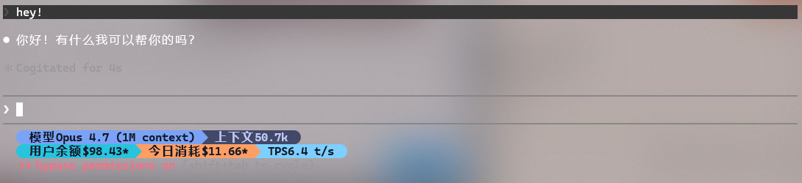

<div align="center">

# mochiapi-statusline

**[MochiAPI](https://mochiapi.com) 用户的 Claude Code 状态栏。**
一条命令装好。终端里看模型、上下文、账户余额、今日花费。

[](https://www.npmjs.com/package/mochiapi-statusline)
[](LICENSE)
[](https://nodejs.org)



</div>

---

## 安装

要 **Node.js ≥ 14**。一条命令装包 + 跑交互式 setup：

```bash
npm install -g mochiapi-statusline && mochiapi-statusline --mochiapi-setup
```

bash / zsh / fish / PowerShell 7+ / cmd.exe 都能跑，`&&` 把装包和 setup 串起来。

> **Windows PowerShell 5.1**（Win10 默认）不支持 `&&`，分两步：
> ```powershell
> npm install -g mochiapi-statusline
> mochiapi-statusline --mochiapi-setup
> ```

先去 <https://mochiapi.com/dashboard> 复制 token，setup 会让你粘贴。`--mochiapi-setup` 做四件事：

1. token + base URL → `~/.config/mochiapi-statusline/config.json`（Windows 是 `%APPDATA%\mochiapi-statusline\config.json`）
2. 探测一次 balance 接口，确认 token 有效
3. 把推荐的 **Mochi 三行 Powerline 布局**写入 `~/.config/mochiapi-statusline/settings.json`（已有布局会把 Mochi 计费行追加进去）
4. 把 Claude Code 的 `~/.claude/settings.json` 里 `statusLine.command` 指向 `mochiapi-statusline`；**Windows 上写入的是当前安装的绝对路径**（如 `"C:\Program Files\nodejs\node.exe" C:\...\dist\mochiapi-statusline.js`），这样即使 Claude 客户端启动时的 PATH 里没有 npm 全局 bin 目录（GUI 启动常见），状态栏也能正常拉起

开一个新的 Claude Code 会话，状态栏就有了。

> **Windows + Powerline**：默认布局用 Nerd Font 字形做分隔符，没装会看到 `?` 方块。装一个并设为终端字体：
>
> ```powershell
> winget install DEVCOM.JetBrainsMonoNerdFont
> ```

`dist/mochiapi-statusline.js` 预构建产物直接打进 npm tarball，包不声明 `prepare` / `postinstall`，安装时不会跑本地构建，bundle 好的 binary 直接落地。

### 备用安装源

只在 npm registry 被墙、或者想跟 `main` HEAD 而不是 tag 发布时用：

```bash
# 跟踪 main HEAD（滚动，无版本锁定）
npm install -g github:Subaru486desuwa/mochiapi-statusline

# 锁到特定 git tag
npm install -g github:Subaru486desuwa/mochiapi-statusline#v0.1.1

# Tarball 直装（下载最小，等价于 github: 简写）
npm install -g https://github.com/Subaru486desuwa/mochiapi-statusline/archive/refs/heads/main.tar.gz
```

## 默认布局长这样

三行 Powerline，金额默认采用剩余/总额：

- 第一行：模型、上下文、分支和改动。
- 第二行：钱包余额、今日消耗。
- 第三行：本站 Claude 套餐的日剩额、总剩额、日重置/周期重置及到期时间。

新版确认当前连接支持 Claude 套餐摘要后，会自动把旧布局迁移为上述布局。旧服务端或连接尚未验证时保留旧布局；旧订阅项不会被标成 Claude。先保存 `settings.json.pre-v4-*.bak` 备份，再校验并原子替换。重复运行不会再次迁移。

额度跟随 Claude Code 当前连接的 `ANTHROPIC_BASE_URL` 和 `ANTHROPIC_AUTH_TOKEN`（或 `ANTHROPIC_API_KEY`）。支持本站 `mochiapi.com` 和 `api.mochiapi.com`；URL 与 token 必须成对，缓存按连接隔离。运行时不使用 setup 中旧账户的 token 补齐缺失连接，非本站连接不展示本站计费项。

Claude 套餐是当前账户持有的套餐概览。即使连接分组是 Codex2cc，也只展示 Claude 套餐；它不表示 Codex2cc 请求会扣 Claude 额度。GPT 套餐额度不展示。结转已包含在总额度里，不重复相加。

在 TUI 中选择 **MochiAPI Claude Quota**，按 `p` 切换数值/已用百分比，保存后生效。默认是数值。数值后面的 `*` 表示旧缓存或刷新失败，同一连接仍显示其上次成功值。

## MochiAPI 自带的 widget

四个 widget 共用 `/api/usage/token/` 的连接缓存：

| Widget 类型 | 渲染 | 默认色 |
|---|---|---|
| `mochiapi-balance` | 钱包剩余金额 | cyan |
| `mochiapi-daily-spend` | 今日消耗金额 | magenta |
| `mochiapi-subscription-balance` | Claude 日余/总余金额与期限，百分比可选 | green |
| `mochiapi-subscription` | 钱包、今日消耗与 Claude 套餐的合并展示 | cyan |

没有有效 Claude 套餐显示“未订阅”；耗尽显示0；无限额度显示∞。旧接口缺少明确 Claude 套餐摘要时显示“数据待升级”，查询失败显示“数据不可用”，不会把 GPT 套餐或未知额度误标为 Claude。

## CLI

```bash
# 再跑一次交互式 setup
mochiapi-statusline --mochiapi-setup

# 非交互（CI / 脚本）
MOCHIAPI_TOKEN=sk-xxxx MOCHIAPI_BASE_URL=https://mochiapi.com \
  mochiapi-statusline --mochiapi-setup

# 只写 mochi 配置，不动 mochiapi-statusline / Claude Code 设置
mochiapi-statusline --mochiapi-setup --skip-statusline --skip-claude-wire

# 手动刷一次余额缓存（后台每 30 秒也会自动刷）
mochiapi-statusline --mochiapi-refresh

# 启动 TUI 调整 widget / 颜色 / 布局 / Powerline
mochiapi-statusline
```

## 升级 / 卸载

```bash
# 升级到最新发布版本
npm install -g mochiapi-statusline@latest

# 卸载
npm uninstall -g mochiapi-statusline
```

## 文件位置

|  | macOS / Linux | Windows |
|---|---|---|
| MochiAPI token + baseUrl | `~/.config/mochiapi-statusline/config.json` | `%APPDATA%\mochiapi-statusline\config.json` |
| 余额缓存 | `~/.cache/mochiapi-statusline/balance-<连接哈希>.json` | `%LOCALAPPDATA%\mochiapi-statusline\cache\balance-<连接哈希>.json` |
| 状态栏布局 | `~/.config/mochiapi-statusline/settings.json` | `%USERPROFILE%\.config\mochiapi-statusline\settings.json` |
| Claude Code | `~/.claude/settings.json` | `%USERPROFILE%\.claude\settings.json` |

token 配置和布局配置是**两个不同的文件**：改鉴权动第一个，改显示哪些 widget 动第二个（或者跑 TUI）。

## 排错

| 状态栏显示 | 含义 | 处理 |
|---|---|---|
| `Mochi: cfg?` | 找不到 `config.json` | 重新跑 `mochiapi-statusline --mochiapi-setup` |
| `Mochi: ...` | 缓存还没填 | 跑 `mochiapi-statusline --mochiapi-refresh`，或等 30 秒 |
| `$X.XX*`（末尾 `*`） | 缓存陈旧 | 通常瞬时上游问题，后台 refresher 会自动重试 |
| 分隔符显示成 `?` | 终端没用 Nerd Font | 装 Nerd Font 并设为终端字体 |

不启动 Claude Code 也能渲染一次看看效果：

```bash
echo '{"session_id":"test","model":{"id":"claude-sonnet-4-6","display_name":"Sonnet 4.6 (1M context)"},"workspace":{"current_dir":".","project_dir":"."},"cost":{"total_cost_usd":0},"transcript_path":"/tmp/nonexistent","output_style":{"name":"default"}}' \
  | mochiapi-statusline
```

## 接口契约

首先读取 `GET ${baseUrl}/api/usage/token/`，Bearer 鉴权，不需要面板 cookie 或登录凭据。旧的钱包兼容路径仍保留。后端需提供新增 `data.claude_subscription` 摘要才能显示 Claude 金额。

| 字段 | 用途 |
|---|---|
| `user_remain_quota_usd` | 钱包现金余额 |
| `today_used_quota_usd`（如有） | 今日消耗；缺失时仅按同一连接的累计差估计 |
| `claude_subscription.status` | `active` / `none` / `unavailable` |
| `claude_subscription.plans[]` | 所属账户生效的 Claude 套餐，`group=vip1_sub` |
| `total_usd / used_usd / remaining_usd / unlimited` | 总额度，已包含结转 |
| `daily_total_usd / daily_used_usd / daily_remaining_usd / daily_unlimited` | 每日额度，与总额度分别限制 |
| `daily_reset_at / reset_at / expires_at` | 日重置、周期重置、到期，Unix 秒 |

重置后的有效额度和在途预留由服务端计算，客户端只格式化。旧 `subscription_*` 字段继续兼容旧客户端，新版不会凭这些未标明产品线的字段推断 Claude 套餐。

开发验证使用 `bun run test`（Vitest）、`bun run lint` 与 `bun run build`。

## 致谢

底层状态栏引擎 fork 自 [sirmalloc/ccstatusline](https://github.com/sirmalloc/ccstatusline)（MIT，© Matthew Breedlove）。MochiAPI 部分的增量只有：

- `mochiapi-balance` / `mochiapi-daily-spend` / `mochiapi-subscription` 四个 widget
- `--mochiapi-setup` / `--mochiapi-refresh` 两个 CLI flag
- 一键 setup（写 config + 写布局 + 接 Claude Code `statusLine.command`）

其余的 TUI、主题、布局、Powerline 渲染、20 多个其它 widget 全部是上游代码，深度自定义照样适用上游的 TUI。

## License

MIT — 见 [LICENSE](LICENSE) 和 [NOTICE](NOTICE)。
